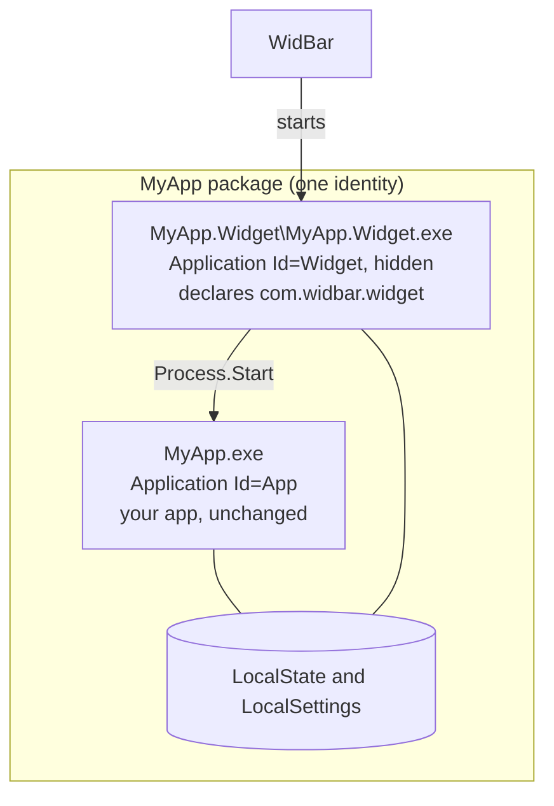

# Companion widgets

If you already ship a packaged WinUI 3 app, the widget does not need a package
of its own. Add a small second executable to the package you already have:
your app stays exactly as it is, and WidBar starts the widget exe like any other
widget. One package, one Store listing, and the widget arrives with the app.



Why a second exe and not the app itself? Your app's startup brings in
everything it needs (WebView2, services, windows); booting all of that to draw a
taskbar spot is heavy and confusing in Task Manager. The widget exe references
only what the widget needs and starts in a moment, and your app never has to
know about widgets.

Both exes share the package identity, so the widget can read what the app
writes in `LocalState` or `LocalSettings`. For shared code, put models and
services in a class library both projects reference.

## 1. Create the widget project

With the templates installed (see [Quick start](Quick-Start.md)), run this next
to your app project:

```powershell
dotnet new widbar-companion -n MyApp `
    --PluginId com.contoso.myapp.companion `
    --DisplayName "My App"
```

It creates `MyApp.Widget/`:

| File | What it is |
| --- | --- |
| `MyApp.Widget.csproj` | The widget exe, with the `WidBarPlugin*` properties |
| `WidgetApp.xaml`, `WidgetApp.xaml.cs` | The application class, derived from `WidgetHostApplication` |
| `Program.cs` | The entry point |
| `MainPlugin.cs` | Your plugin, the ordinary [plugin contract](API-Reference.md#iwidgetplugin) |
| `app.manifest` | Per-monitor DPI awareness |
| `Properties\PublishProfiles\*.pubxml` | Publish profiles for x64 and ARM64 |

Add the project to your solution. The application class is called
`WidgetApp.xaml` on purpose: your app already ships an `App.xbf` at the root of
the package, and two files with the same name collide when packaging.

## 2. Wire it into your packaging project

Your existing `.wapproj` gets a project reference and the `plugin.json` link:

```xml
<ProjectReference Include="..\MyApp.Widget\MyApp.Widget.csproj">
  <SkipGetTargetFrameworkProperties>True</SkipGetTargetFrameworkProperties>
  <PublishProfile>Properties\PublishProfiles\win-$(Platform).pubxml</PublishProfile>
</ProjectReference>

<Content Include="..\MyApp.Widget\obj\widbar\plugin.json">
  <Link>Public\plugin.json</Link>
</Content>
```

Let the packaging project put the widget's output in its own folder. Don't also
copy `MyApp.Widget.exe` or its `.deps.json` and `.runtimeconfig.json` to the
package root: the widget must start from the folder that holds its own files.

## 3. Declare the widget as a second Application

WidBar starts the Application that declares the `com.widbar.widget` extension.
Put the extension on your main app's `<Application>` and WidBar would boot your
whole app as the widget. So the widget gets its own entry, hidden from the
Start menu, next to your app's entry in `<Applications>`:

```xml
<Application Id="Widget"
    Executable="MyApp.Widget\MyApp.Widget.exe"
    EntryPoint="Windows.FullTrustApplication">
  <uap:VisualElements
      DisplayName="My App Widget"
      Description="My App taskbar widget"
      BackgroundColor="transparent"
      AppListEntry="none"
      Square150x150Logo="Images\Square150x150Logo.png"
      Square44x44Logo="Images\Square44x44Logo.png" />
  <Extensions>
    <uap3:Extension Category="windows.appExtension">
      <uap3:AppExtension Name="com.widbar.widget" Id="myappcompanion"
                         PublicFolder="Public" DisplayName="My App"
                         Description="Quick access to My App from the taskbar.">
        <uap3:Properties>
          <WidBarPluginId>com.contoso.myapp.companion</WidBarPluginId>
          <WidBarSdkVersion>2</WidBarSdkVersion>
        </uap3:Properties>
      </uap3:AppExtension>
    </uap3:Extension>
  </Extensions>
</Application>
```

`AppListEntry="none"` keeps the widget out of the Start menu; reuse your app's
logos for the required attributes, and add the `uap3` namespace at the top if
it is missing. Packages with several Applications are fully supported by MSIX
and the Store.

## Talking to your app

| You want to | Do this |
| --- | --- |
| Open or focus the app from the flyout | Start the sibling exe: `Process.Start(new ProcessStartInfo(Path.Combine(AppContext.BaseDirectory, "..", "MyApp.exe")) { UseShellExecute = true })`. A single-instance app focuses its window |
| Show the app's data | Have the app write it to `ApplicationData.Current.LocalFolder` or `LocalSettings`, and read it in the widget, on a timer or in `OnFlyoutShown` |
| Share code | A class library referenced by both projects, without assumptions about a main window |

Adjust the relative path to where your app's exe sits in the package payload.

## Pitfalls

| Symptom | Cause | Fix |
| --- | --- | --- |
| "Unable to find project information for ...Widget.csproj" or "...Widget.exe is not part of the payload" | The widget project is not in the solution | Add it to the solution |
| Packaging fails on files with the same name and different content | The app and the widget use different Windows App SDK versions | Use the same version in both; WidBar.SDK 2.2.2 needs 2.5.1 or later |
| "Two or more files with the same destination path" for `App.xbf` | The widget's application class is called `App.xaml` | Keep the name `WidgetApp.xaml` from the template |
| WidBar starts your whole app instead of the widget | The extension sits on the main `<Application>` | Move it to the widget's own `<Application>` |

## Deploy and test

Build and deploy the packaging project as usual. The widget shows up in
WidBar's catalog like any other; use **Refresh** on the Layout page after a new
deploy. It has the same features as a standalone widget: themes, Smart Stack
visibility, attention requests and settings.

If the widget exe itself should also work as a normal app when started from
the Start menu, override `OnLaunched` in its application class, check
`IsWidBarHostLaunch()`, and call `base.OnLaunched(args)` only when it returns
`true`. Otherwise open your own window.
