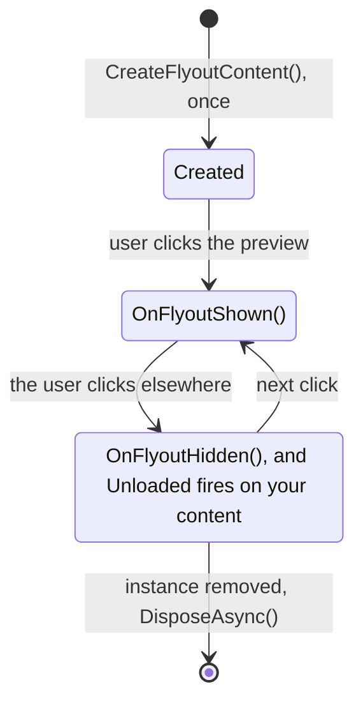

# Flyout

The flyout is the panel that opens above the taskbar when the user clicks your
preview. Return its content from `CreateFlyoutContent()`, or `null` if your
widget has no flyout. It is a real window, so anything goes: scrolling, text
input, lists, charts.

```csharp
public override int FlyoutWidth => 360;
public override int FlyoutHeight => 420;

public override UIElement? CreateFlyoutContent() => new ForecastView(_settings);
```

## Size

| | |
| --- | --- |
| `FlyoutWidth`, `FlyoutHeight` | The starting size in logical pixels. Defaults 390 by 480 |
| When they are read | Once, when the instance starts. Changing them later has no effect |
| User resizing | The user can resize the flyout and WidBar remembers their size, which then wins over yours |
| Other displays | The size is logical, so the flyout keeps the same size on a display at another scale |

## It lives longer than you think

`CreateFlyoutContent()` is called **once**, possibly before the user opens the
flyout for the first time, so don't treat it as "the flyout is now visible":
that is what `OnFlyoutShown()` is for. Closing the flyout hides it; your content
is kept and shown again at the next open.



Two things follow from that:

- `Unloaded` fires on your content at every close. If you drop subscriptions
  or bindings there, the next open shows a UI that never updates again.
- Timers and polling should still pause while the flyout is hidden. Implement
  `IWidgetFlyoutLifecycle` and the SDK tells you when it shows and hides.

```csharp
public sealed class WeatherPlugin : WidgetPluginBase, IWidgetFlyoutLifecycle
{
    public void OnFlyoutShown()
    {
        _view?.Refresh();     // one fresh render
        _timer?.Start();
    }

    public void OnFlyoutHidden() => _timer?.Stop();
}
```

The rule of thumb: pause work when hidden, never disconnect state.

## Opening and closing

The flyout slides up out of the taskbar's edge when it opens and back into it
when it closes, the way Windows quick settings do. Loading content in
`OnFlyoutShown` does not make the animation stutter, so that is a good place to
refresh your data.

To open the flyout from code, call `Context.RequestOpenFlyout()`. It only
opens, never closes, so calling it repeatedly is safe. Its main use is drag and
drop, see [Taskbar preview](Taskbar-Preview.md#drag-and-drop).

## The background

You don't choose the material behind the flyout, the user does. WidBar's
settings offer acrylic, dense acrylic and Mica (acrylic by default), and the
choice applies to every widget and changes live. Leave the root of your flyout
without a background so the material shows through, and bring your own
padding.

The panel has rounded corners and clips your content to them, so a picture
along its top edge needs no corners of its own.

Older SDKs had a `FlyoutBackdrop` property for this. It still compiles, but it
is ignored and marked obsolete: delete the override.

## Dialogs and pickers

A file picker or a message dialog takes the focus, and losing focus normally
closes the flyout, taking the dialog with it. Keep the flyout open while the
dialog is up:

```csharp
using var modal = WidgetFlyout.EnterModalScope();
var folder = await picker.PickSingleFolderAsync();
```

The flyout closes on outside clicks again once the scope is disposed. Scopes
nest.

## The settings button

If your plugin implements `IConfigurableWidgetPlugin`, the flyout gets a gear
button that opens your settings. See [Settings](Settings.md).
