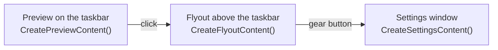

# WidBar widget developer guide

WidBar puts widgets on the Windows 11 taskbar. A widget is a small packaged
WinUI 3 app built with `WidBar.SDK`: you write the UI and the logic, and the
SDK takes care of the taskbar, the flyout window, the settings window and the
lifecycle of every copy the user places.

This guide covers **WidBar.SDK 2.2.2**.

## What a widget is made of

A widget is a small app of its own. Once it is installed, it appears in
WidBar's catalog and the user places it on the taskbar. From there the user
sees up to three things, and each one is plain WinUI 3 content you return from
one method:

| Surface | Where it appears | You return it from |
| --- | --- | --- |
| Preview | A free spot on the taskbar, always visible | `CreatePreviewContent()` |
| Flyout | A panel above the taskbar, opened by a click on the preview | `CreateFlyoutContent()` |
| Settings | A window with Save and Cancel, opened from the flyout or from WidBar | `CreateSettingsContent(...)` |

## Where to go next

| If you want to | Read |
| --- | --- |
| Get a widget on the taskbar in a few minutes | [Quick start](Quick-Start.md) |
| Know when your code runs, copies and threads | [Lifecycle](Lifecycle.md) |
| Build what sits on the taskbar | [Taskbar preview](Taskbar-Preview.md) |
| Build the panel that opens above it | [Flyout](Flyout.md) |
| Let users configure the widget | [Settings](Settings.md) |
| Look up a type or a member | [API reference](API-Reference.md) |
| Ship it on the Microsoft Store | [Packaging and publishing](Packaging-and-Publishing.md) |
| Add a widget to an app you already ship | [Companion widgets](Companion-Widgets.md) |
| Find out why something does not work | [Debugging](Debugging.md) and the [FAQ](FAQ.md) |
| See what changed between versions | [Changelog](Changelog.md) |

## What you need

| | |
| --- | --- |
| Windows | Windows 11, x64 or ARM64, with Developer Mode turned on |
| Tools | Visual Studio 2026 with the WinUI application development workload, or the .NET 10 SDK and MSBuild |
| Packages | `WidBar.SDK` 2.2.2 and `Microsoft.WindowsAppSDK` 2.5.1 or later |
| Host | [WidBar](https://apps.microsoft.com/detail/9PKLDNM83TP9) from the Microsoft Store |

## Links

- SDK package: [WidBar.SDK on NuGet](https://www.nuget.org/packages/WidBar.SDK)
- Templates: [andelby/widbar-widget-template](https://github.com/andelby/widbar-widget-template)
- WidBar, issues and the widget catalog: [andelby/widbar](https://github.com/andelby/widbar)
