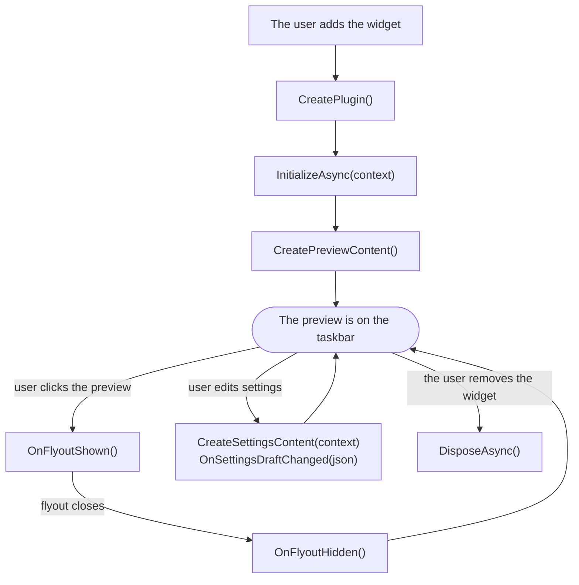

# Lifecycle

When your code runs, and what each method is for.

## What you write, what WidBar handles

| You write | WidBar handles for you |
| --- | --- |
| The plugin class | Placing the widget on the taskbar |
| The preview, flyout and settings UI | Hover, pressed state and the click that opens the flyout |
| Your data, timers and network calls | Opening, positioning and closing the flyout |
| Your settings model and its JSON | The settings window with Save and Cancel, and storing the JSON |
| Cleanup in `DisposeAsync` | Light and dark themes, Smart Stacks, restarting after a crash |

## When your code is called

| Method | Called | Use it to |
| --- | --- | --- |
| `CreatePlugin()` | For each copy of the widget | Return a new plugin object. Keep the constructor light |
| `InitializeAsync(context)` | Once, before anything is shown | Read settings, start timers and network calls |
| `CreatePreviewContent()` | Once, after `InitializeAsync` | Build the taskbar preview |
| `CreateFlyoutContent()` | Once, before the flyout is first needed | Build the flyout; the same content is shown at every open |
| `OnFlyoutShown()` / `OnFlyoutHidden()` | At every open and close | Resume and pause flyout work (optional, `IWidgetFlyoutLifecycle`) |
| `CreateSettingsContent(context)` | Each time the settings window opens | Build the settings page (optional, `IConfigurableWidgetPlugin`) |
| `OnSettingsDraftChanged(json)` | While settings are edited, after Save, after Cancel | Apply the settings to the preview |
| `DisposeAsync()` | When the copy is removed or WidBar closes | Stop timers, drop subscriptions |

The SDK may create plugin objects that are never initialized, so don't start
work in the constructor: do it in `InitializeAsync`.

What WidBar reads from your plugin, and when:

| Property | Read |
| --- | --- |
| `PreviewLogicalWidth` | After `InitializeAsync` and after every settings change |
| `IsPreviewVisible` | After `InitializeAsync` and when you call `RequestPreviewRefresh()` |
| `FlyoutWidth`, `FlyoutHeight`, `HighlightPreviewOnHover` | Once, when the widget starts |

## Copies of your widget

The user can place your widget more than once, for example on two displays.
Each copy has its own plugin object, settings and `InstanceId`.

| Shared by all copies | Separate for each copy |
| --- | --- |
| Your process and anything `static` | The plugin object and its fields |
| `DataDirectory` | `SettingsJson` and `InstanceId` |
| Your package's `LocalState` and `LocalSettings` | Preview, flyout and settings window |

Keep state in instance fields. Anything in a `static` field is shared by every
copy, which is almost never what you want. For files in `DataDirectory` that
belong to one copy, put the `InstanceId` in the file name.

## Threads

| Call | Thread |
| --- | --- |
| `CreatePreviewContent`, `CreateFlyoutContent`, `CreateSettingsContent` | UI thread |
| `OnSettingsDraftChanged`, `OnFlyoutShown`, `OnFlyoutHidden` | UI thread |
| `PreviewVisibilityChanged` | Raised on the UI thread |
| `RequestAttention` | Safe from any thread |

If your data arrives on a background thread (a timer, a network reply), go back
to the UI thread with the element's `DispatcherQueue` before touching XAML.

## Light and dark

The preview sits on the taskbar, so it follows the **taskbar's** theme, which
the user can set apart from the apps' theme in Windows settings. Your preview,
flyout and settings all get it. Use `ThemeResource` brushes and there is
nothing else to do. If you build brushes in code, take the theme from the
element's `ActualTheme`, not from `Application.Current.RequestedTheme`.

## Errors and crashes

Exceptions thrown from the SDK's methods (`InitializeAsync`, the `Create*`
methods and the rest) are caught and shown in WidBar's developer console, see
[Debugging](Debugging.md). An unhandled exception on a background thread still
ends your process.

If the process ends unexpectedly, WidBar starts the widget again. After three
crashes in a row the widget is turned off until the user turns it back on. So
catch exceptions in timers and network callbacks, and show something sensible
instead.

## Started without WidBar

If someone starts your exe from the Start menu or by double-clicking it, there
is no taskbar spot to fill, so the SDK shows a small window explaining that the
widget runs inside WidBar. If your exe should also work as a normal app in that
case, see [Companion widgets](Companion-Widgets.md#deploy-and-test).

## Versions

Set `WidBarPluginMinHostVersion` in your project to the oldest WidBar your
widget needs. Older versions of WidBar skip the widget instead of failing on it.
