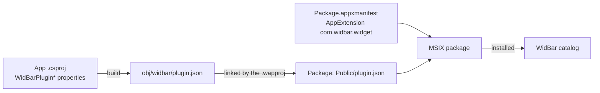

# Packaging and publishing

A widget ships as an MSIX package. WidBar finds it through a Windows
AppExtension, and three pieces make that work: the project properties, the
generated `plugin.json` and the package manifest. The templates set all of it
up; this page explains what each piece does so you know what you are changing.



## 1. Project properties

Set these in the app project (`*.ExtensionApp.csproj`). The SDK writes
`obj\widbar\plugin.json` from them on every build; you never edit the JSON.

```xml
<PropertyGroup>
  <WidBarPluginId>com.contoso.weather</WidBarPluginId>
  <WidBarPluginName>Weather</WidBarPluginName>
  <WidBarPluginDescription>Current conditions and forecasts on the taskbar.</WidBarPluginDescription>
  <WidBarPluginCategory>Information</WidBarPluginCategory>
  <WidBarPluginVersion>1.0.0</WidBarPluginVersion>
  <WidBarPluginPreviewWidth>188</WidBarPluginPreviewWidth>
  <WidBarPluginConfigurable>true</WidBarPluginConfigurable>
  <!-- optional: the oldest WidBar the widget works with -->
  <WidBarPluginMinHostVersion>1.0.0</WidBarPluginMinHostVersion>
</PropertyGroup>
```

All properties and their defaults are in the [API reference](API-Reference.md#project-properties).
Keep `WidBarPluginId` identical to the `Id` your plugin returns. The
description and category people see in WidBar's catalog come only from here,
not from the plugin class.

## 2. The package manifest

`Package.appxmanifest` declares the AppExtension. Its name must be exactly
`com.widbar.widget`, and its public folder must contain the generated
`plugin.json`:

```xml
<uap3:Extension Category="windows.appExtension">
  <uap3:AppExtension Name="com.widbar.widget" Id="weather"
                     PublicFolder="Public" DisplayName="Weather">
    <uap3:Properties>
      <WidBarPluginId>com.contoso.weather</WidBarPluginId>
      <WidBarSdkVersion>2</WidBarSdkVersion>
    </uap3:Properties>
  </uap3:AppExtension>
</uap3:Extension>
```

The package also needs the `runFullTrust` capability. The packaging project
links the manifest into `Public`:

```xml
<Content Include="..\Contoso.Weather.ExtensionApp\obj\widbar\plugin.json">
  <Link>Public\plugin.json</Link>
</Content>
```

Everything else, your DLLs managed or native, ships as normal payload next to
the executable. Your widget runs in its own process, so there are no version
conflicts with WidBar or other widgets.

## 3. Runtime and architectures

| Setting | Template value | Why |
| --- | --- | --- |
| Platforms | x64 and ARM64 | What Windows 11 runs on. x86 is not needed |
| .NET | self-contained (`SelfContained` true) | No .NET runtime to install |
| Windows App SDK | framework package (`WindowsAppSDKSelfContained` false) | The Store installs `Microsoft.WindowsAppRuntime.2` for the user |
| Bundle | one `.msixupload` with both architectures | One file to upload |

MSIX takes `RuntimeIdentifier` and `SelfContained` from the publish profiles
in `Properties\PublishProfiles\win-*.pubxml`, not from the `.csproj`. Keep those
files in source control: Visual Studio's standard `.gitignore` ignores
`*.pubxml`, and a clean checkout without them fails on the ARM64 build.

## 4. Building a Store package

In Visual Studio: **Publish > Create App Packages**, Microsoft Store, x64 and
ARM64. From the command line, restore and build as **two separate steps**:

```powershell
$project = "Contoso.Weather (Package)\Contoso.Weather (Package).wapproj"
msbuild $project -t:Restore -p:Configuration=Release -p:Platform=x64
msbuild $project -t:Build -p:Configuration=Release -p:Platform=x64 `
    -p:AppxBundle=Always "-p:AppxBundlePlatforms=x64|arm64" `
    -p:UapAppxPackageBuildMode=StoreUpload -p:AppxAutoIncrementPackageRevision=false
```

The result is a `.msixupload` in `AppPackages`.

## 5. Publishing on the Microsoft Store

1. Reserve the name in [Partner Center](https://partner.microsoft.com/dashboard).
2. Associate the packaging project with it (Visual Studio: **Publish > Associate
   App with the Store**). This sets the package identity and publisher.
3. Upload the `.msixupload` under **Packages** in a new submission. The Store
   signs the package, so you don't need a certificate of your own.

To update, raise the package version in `Package.appxmanifest` (the Store wants
the fourth number at 0, like `1.2.0.0`) and `WidBarPluginVersion`, build and
submit again. Users get it through normal Store updates.

## 6. Getting into WidBar's showcase

WidBar has an in-app showcase of widgets, read from a public catalog. Listing
is free: open a pull request against [andelby/widbar](https://github.com/andelby/widbar)
that adds your widget to `catalog.json`:

```json
{
  "id": "contoso-weather",
  "pluginId": "com.contoso.weather",
  "name": "Weather",
  "summary": "Current conditions and forecasts on the taskbar.",
  "description": "A longer text for the widget's page in the showcase.",
  "publisher": "Contoso",
  "category": "information",
  "storeProductId": "9NXXXXXXXXXX",
  "iconUrl": "https://example.com/weather.png",
  "localizations": { "it-IT": { "name": "Meteo", "summary": "..." } }
}
```

`pluginId` must match your widget's id; WidBar uses it to show an "Installed"
badge. `storeProductId` is your Store product id, and `category` is one of the
ids at the top of `catalog.json` (`system`, `media`, `productivity`,
`information`, `utility`).

## Pitfalls

| Symptom | Cause | Fix |
| --- | --- | --- |
| The widget is not in WidBar's catalog | The package was built but not installed, `plugin.json` is not in `Public`, or the extension name changed | Deploy the package, check the `Content` link and `Name="com.widbar.widget"` |
| ARM64 build fails with NETSDK1032 | The `.pubxml` files are missing | Add them to source control |
| A bundle fails in MakeAppx (80080204) | Restore and build ran in one MSBuild call | Run `-t:Restore` and `-t:Build` separately |
| Only some languages show up after a Store install | Language folders were split into resource packs | If you load `Strings\<lang>\*.resw` yourself at run time, set `AppxBundleAutoResourcePackageQualifiers` to `Scale` in the `.wapproj` |
| MakeAppx cannot find your exe in a Store build | A manifest extension names a fixed `Executable` | Let extensions inherit the Application's executable; Store builds put the app in a subfolder |
| The Store rejects the version | The fourth number is not 0 | Use versions like `1.2.0.0` |
