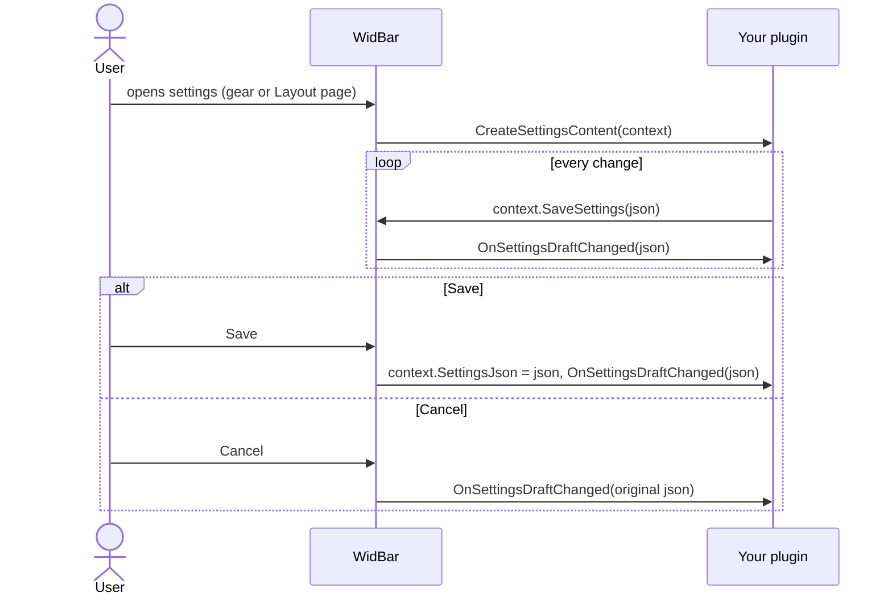

# Settings

If your widget has anything to configure, implement `IConfigurableWidgetPlugin`.
Two things happen as soon as you do: the flyout gets a gear button, and
WidBar's Layout page can open your settings for each placed copy. Both open the
same window, with Save and Cancel buttons in the user's language.

## Your settings are your JSON

WidBar does not know what your settings contain. It stores one JSON string per
instance and hands it back next time:

| Where | What you get |
| --- | --- |
| `IWidgetContext.SettingsJson` | The saved JSON of this instance, at `InitializeAsync` and after every save |
| `IWidgetSettingsContext.SettingsJson` | The same JSON, when the settings window opens |
| `IWidgetSettingsContext.SaveSettings(json)` | Updates the pending JSON. It is stored when the user presses Save |

A new instance has no settings yet (an empty string or `{}`), so give every
setting a default.

## The flow



`OnSettingsDraftChanged` is what makes the taskbar follow along while the user
drags a slider. On Cancel it is called once more with the original JSON, so
applying whatever you receive undoes the draft for free. Saving does not restart
anything, and WidBar reads `PreviewLogicalWidth` again afterwards.

## A complete example

A small settings model:

```csharp
internal sealed class ClockSettings
{
    public bool Use24h { get; set; } = true;
    public bool Compact { get; set; }

    public static ClockSettings FromJson(string? json)
    {
        try
        {
            return string.IsNullOrWhiteSpace(json)
                ? new ClockSettings()
                : JsonSerializer.Deserialize<ClockSettings>(json) ?? new ClockSettings();
        }
        catch (JsonException)
        {
            return new ClockSettings();
        }
    }

    public string ToJson() => JsonSerializer.Serialize(this);
}
```

The plugin reads it at start, shows a settings page, and applies drafts:

```csharp
public sealed class ClockPlugin : WidgetPluginBase, IConfigurableWidgetPlugin
{
    private ClockSettings _settings = new();

    public override int PreviewLogicalWidth => _settings.Compact ? 90 : 150;

    public override async Task InitializeAsync(IWidgetContext context)
    {
        _settings = ClockSettings.FromJson(context.SettingsJson);
        await base.InitializeAsync(context);
    }

    public UIElement? CreateSettingsContent(IWidgetSettingsContext context)
    {
        var draft = ClockSettings.FromJson(context.SettingsJson);

        var use24h = new ToggleSwitch { Header = "Use the 24-hour clock", IsOn = draft.Use24h };
        use24h.Toggled += (_, _) =>
        {
            draft.Use24h = use24h.IsOn;
            context.SaveSettings(draft.ToJson());
        };

        var compact = new ToggleSwitch { Header = "Compact", IsOn = draft.Compact };
        compact.Toggled += (_, _) =>
        {
            draft.Compact = compact.IsOn;
            context.SaveSettings(draft.ToJson());
            context.RequestPreviewRefresh(); // the width depends on it
        };

        return new StackPanel { Spacing = 16, Children = { use24h, compact } };
    }

    public override void OnSettingsDraftChanged(string settingsJson)
    {
        _settings = ClockSettings.FromJson(settingsJson);
        UpdatePreview();
    }
}
```

## Tips

| Situation | Do this |
| --- | --- |
| A setting changes the preview width or visibility | Call `RequestPreviewRefresh()` after `SaveSettings` |
| The JSON on disk comes from an older version of your widget | Read it leniently: unknown fields ignored, missing ones defaulted |
| You want a section look like Windows settings | Build cards with `Border` and `ThemeResource` brushes; WinUI control libraries also work, merged in `App.xaml` |
| The gear button never shows | Your plugin does not implement `IConfigurableWidgetPlugin` |

Set `WidBarPluginConfigurable` to `true` in your project as well, so WidBar's
catalog knows the widget has settings (see
[Packaging and publishing](Packaging-and-Publishing.md)).
